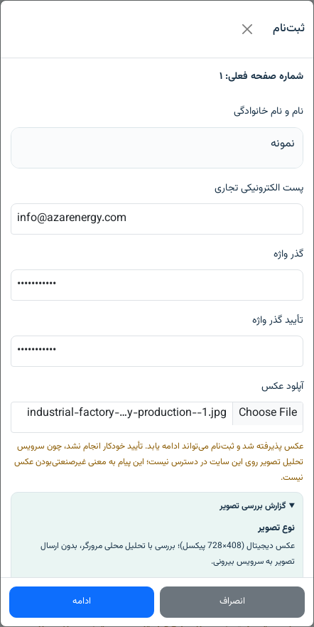

# اصلاح بررسی عکس در فرم ثبت‌نام

**فایل تغییریافته:** `index.html` — فایل‌های `supabase.js`، `cloud.js`، `purify.min.js` و SQLها دست‌نخورده‌اند.

## علت پیام خطا

بررسی عکس ثبت‌نام فقط از یک نقطهٔ پایانی سروری می‌خواند:

```
POST /api/validate-photo
```

و پاسخ آن را در ۵ ثانیه، فقط با یک قالب JSON بسیار سخت‌گیرانه (نسخهٔ ۳، شامل `requestId`، `imageSha256`، گزارش هفت‌بخشی فارسی و نتیجهٔ `aiDetection`) می‌پذیرفت.

این بسته هیچ بک‌اندی همراه ندارد؛ روی هاست ایستا چنین مسیری وجود ندارد. بنابراین **هر** عکسی، حتی عکس صنعتی درست، رد می‌شد و همان پیام «سرویس تحلیل تصویر در دسترس نیست…» نمایش داده می‌شد. پیام خطا هم نبودِ سرویس را از «محتوای نامناسب» تفکیک نمی‌کرد.

## رفتار جدید

| وضعیت | نتیجه | پیام |
|---|---|---|
| سرویس معتبر پاسخ `accept` بدهد | پذیرش + برچسب «تأیید شد» | «عکس بر اساس پاسخ سرویس تحلیل تصویر تأیید شد.» |
| سرویس نباشد / ۴۰۴ / HTML / هش ناهمخوان / دیرکرد | ادامهٔ ثبت‌نام مجاز است | «عکس پذیرفته شد و ثبت‌نام می‌تواند ادامه یابد. تأیید خودکار انجام نشد…» |
| تحلیل محلی چهره/افراد ببیند | توقف با راهنمای مشخص | «به نظر می‌رسد کانون این عکس افراد یا چهره‌هاست…» |
| آسمان‌غالب / منظره | توقف با راهنمای مشخص | «این عکس بیشتر منظره، آسمان یا فضای سبز است…» |
| اسکرین‌شات، سند، لوگو، طرح گرافیکی | توقف با راهنمای مشخص | «این تصویر بیشتر شبیه اسکرین‌شات، سند…» |
| سرویس پاسخ `reject` بدهد | توقف | «این عکس تأیید نشد…» |

نکته‌های مهم:

- **تحلیل محلی هیچ‌گاه تأیید صادر نمی‌کند**؛ فقط ناسازگاری آشکار را تشخیص می‌دهد. عکس‌های واقعیِ صنعتی، غذا و منظره در آزمون همگی به مسیر «پذیرفته‌شده ولی تأییدنشده» رفتند و کسی مسدود نشد.
- بررسی سالم‌بودن فایل حفظ شده است: JPEG/PNG/WebP، حداقل ۲۰۰×۲۰۰، حداکثر ۸ مگابایت و ۶۴ مگاپیکسل، بدون تصویر متحرک، و رد فایل‌هایی که خود را «ساخته‌شده با مدل هوش مصنوعی» معرفی می‌کنند.
- مهلت کل ۵ ثانیه، سقف انتظار برای سرویس ۲٫۲ ثانیه؛ سرویس کند یا بی‌پاسخ، فرم را قفل نمی‌کند.
- گزارش «بررسی تصویر» هفت بخش فارسی دارد و از سنجه‌های واقعی همان عکس ساخته می‌شود (خواندن متن تصویر را ادعا نمی‌کند).

## اگر رفتار سخت‌گیرانهٔ قبلی را می‌خواهید

پیش از بارگذاری اسکریپت اصلی، در `index.html` یا در یک اسکریپت جدا:

```html
<script>window.MYAPP_PHOTO_STRICT = true;</script>
```

در این حالت عکسِ تأییدنشده اجازهٔ ادامه نمی‌گیرد و برای تأیید واقعی، به یک سرویس `/api/validate-photo` نیاز دارید که JSON معتبر برگرداند (`{"decision":"accept","industrial":true,"imageSha256":"…"}` کافی است).

## نصب

فقط `index.html` را با نسخهٔ جدید جایگزین کنید و بقیهٔ فایل‌ها را همان‌جا نگه دارید. SQL یا تنظیمات Supabase تغییری لازم ندارد.

## حجم

`index.html` از ۲۱۲٬۲۱۲ بایت به ۲۰۹٬۲۲۴ بایت رسید (حدود ۳ کیلوبایت کمتر)؛ پرامپت و طرح‌وارهٔ سنگین سمت کلاینت حذف و با تحلیل محلی فشرده جایگزین شد. هیچ کتابخانه، دارایی یا درخواست شبکه‌ای تازه‌ای اضافه نشده است.

## آزمون‌ها

۳۳ بررسی در Chromium واقعی روی فایل نهایی:

- ۶ عکس واقعی: دو عکس خط تولید/کارخانه، پرترهٔ شخص، منظرهٔ کوه و دریاچه، سند فاکتور، عکس غذا.
- ۱۵ سناریوی سرویس: نبود سرویس، ۴۰۴، پاسخ HTML، پذیرش، رد، هش ناهمخوان، پاسخ بی‌پایان.
- ۴ سناریوی حالت سخت‌گیرانه و فایل نامعتبر.
- ۲ آزمون کامل رابط کاربری: انتخاب عکس → «ادامه» → ادامهٔ ساخت حساب (یا رد با علامت توقف و پیام مشخص).

سرویس تحلیل و Supabase در این آزمون‌ها شبیه‌سازی یا مسدود شدند؛ این نتایج تأیید دقت تشخیص تصویر یا استقرار روی سرور واقعی شما نیست.


